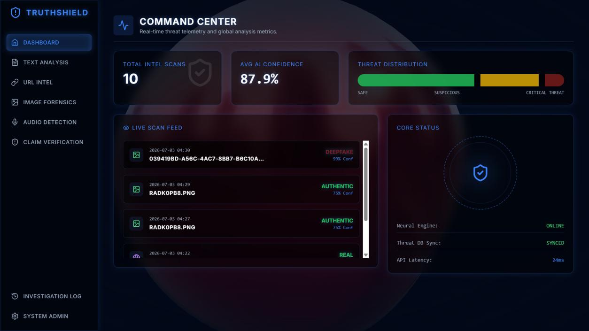
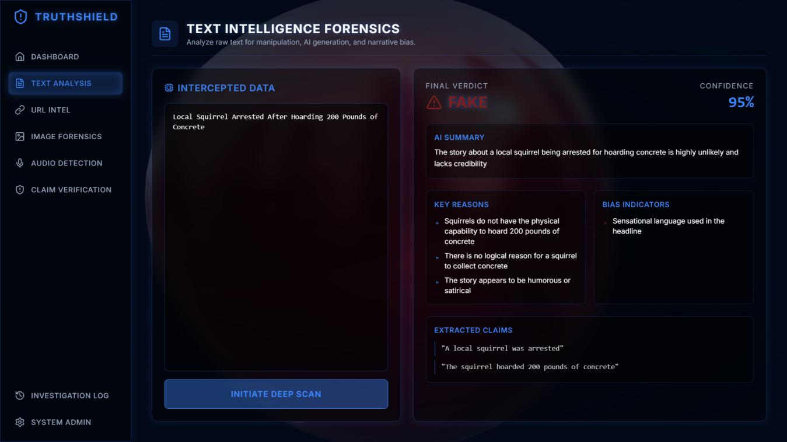
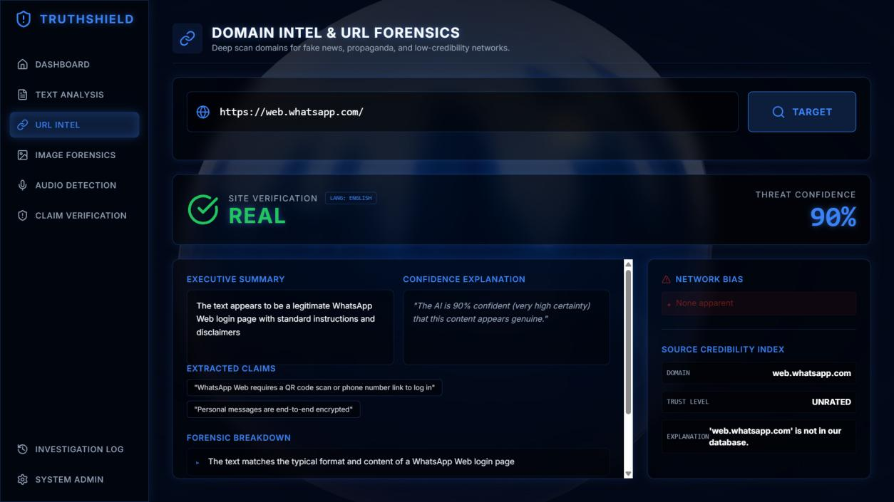
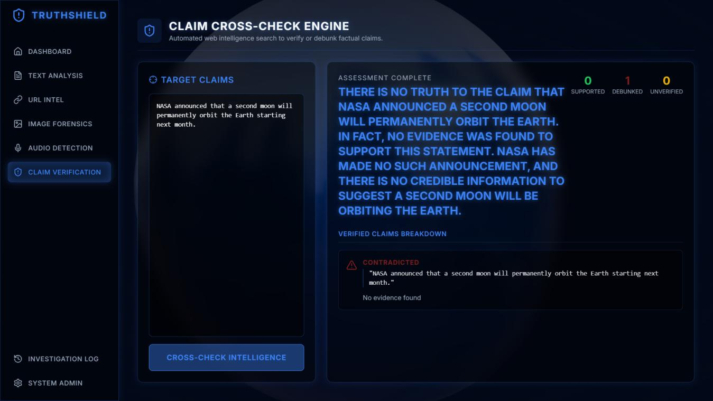
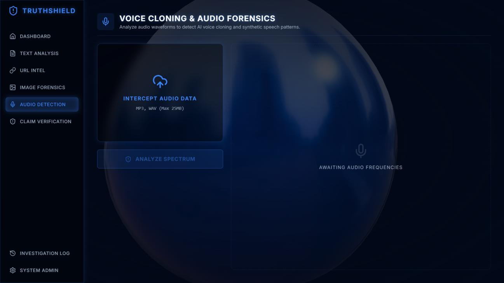
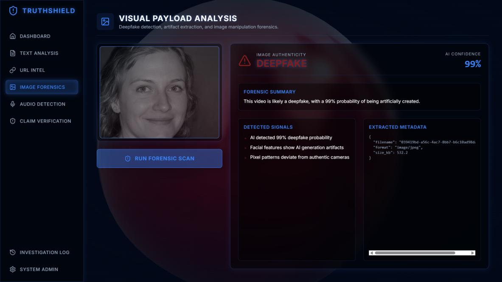

<h1 align="center">🛡️ TruthShield</h1>

<h3 align="center">AI-Powered Digital Content Verification Platform</h3>

<p align="center"><i>Detect misinformation. Verify authenticity. Protect truth.</i></p>

<p align="center">
  <a href="https://truthshiled-abcdefg.vercel.app/analyze/text"></a>
  
  
  
</p>

<p align="center">
  
</p>

---

## 📌 Overview

TruthShield is an AI-based platform that detects **fake news, deepfakes, and manipulated media** using machine learning, digital forensics, and cyber threat intelligence techniques.

It verifies content across **text, URLs, images, and audio**, and returns an explainable verdict with a confidence score, so users can make informed decisions in seconds instead of spending hours on manual research.

**Built for:** journalists and fact-checkers, cybersecurity professionals, law enforcement, compliance teams, researchers, and everyday users.

---

## 🚨 Problems It Addresses

| Threat | Description |
| --- | --- |
| **Misinformation** | False claims spread faster than verified facts and erode public trust |
| **Deepfakes** | AI-generated images and voices that humans cannot reliably identify |
| **Phishing & Fraud** | Malicious URLs, typosquatted domains, and fake news sites |

---

## ✨ Features

### 📝 Text Analysis
Evaluates articles, social posts, and WhatsApp forwards for misinformation, bias, and manipulation using Groq-powered **Llama 3.3 70B**.
- Verdict: `REAL` / `FAKE` / `SUSPICIOUS` / `UNVERIFIABLE` with a 0–100% confidence score
- Claim extraction, bias indicator tagging, sensational language detection
- Multilingual support

<p align="center"></p>

### 🔗 URL Verification
Fetches the page, assesses the domain, and returns a risk profile within seconds.
- Domain reputation checked against 60+ known fake-news and malicious domain lists
- Phishing signals: redirect chains, homograph attacks, typosquatting
- Domain age, TLS/SSL validation, and server IP geolocation
- SSRF-protected URL handling and exportable risk report

<p align="center"></p>

### ✅ Claim Verification
Isolates each factual claim and cross-checks it against real-time web search results.
- Per-claim verdict: `SUPPORTED` / `CONTRADICTED` / `UNVERIFIED`
- Credible sources (Reuters, BBC, WHO) weighted more heavily
- Individual confidence score for every claim

<p align="center"></p>

### 🎙️ Audio Deepfake Detection
Detects synthetic and cloned speech using a HuggingFace speech classification model plus acoustic metadata analysis.
- Supports MP3 and WAV (up to 25 MB)
- Fallback acoustic analysis if the model is unavailable
- Chain-of-custody logging for uploads

<p align="center"></p>

### 🖼️ Image Deepfake Detection
A two-layer forensic pipeline for AI-generated and manipulated images.
- **Layer 1:** HuggingFace classifier (`dima806/deepfake_vs_real_image_detection`) for pixel-level GAN/diffusion patterns
- **Layer 2:** Groq Llama 4 Scout vision model for skin texture, eye reflections, lighting, and edge inspection
- Verdict: `DEEPFAKE` / `AUTHENTIC` / `SUSPICIOUS`, with EXIF metadata extraction and software fingerprint detection
- Supports JPG, PNG, WEBP (up to 10 MB)

<p align="center"></p>

### 📊 Analytics Dashboard
A real-time **Command Center** showing total scans, average AI confidence, threat distribution, a live scan feed, and system status.

### 📄 Forensic PDF Reports
Downloadable PDF reports for every analysis, with **SHA-256 tamper detection** for evidence integrity.

### 🧩 Chrome Extension API
An API endpoint that lets a browser extension submit content for verification.

---

## 🔄 How It Works

```
User Input → Content Routing → AI Processing → Verification Engine → Risk Analysis → Final Verdict
```

1. **User input:** text, URL, image, or audio via the web app, API, or browser extension
2. **Content routing:** content type detected, rate limiting and SSRF protection applied
3. **AI processing:** Llama 3.3 70B for text/URLs, HuggingFace models for images and audio, vision model for media inspection
4. **Verification engine:** claims cross-checked via live search, domain reputation assessed, metadata inspected
5. **Risk analysis:** all signals aggregated into a composite risk profile
6. **Final verdict:** result with confidence score, reasoning, extracted claims, bias indicators, and PDF report

---

## 🔐 Security

- JWT authentication with bcrypt password hashing
- Per-IP rate limiting on all endpoints
- SSRF protection on all URL inputs
- Audit-friendly chain-of-custody logging for uploads
- SHA-256 hashing on generated reports

---

## 🛠️ Tech Stack

| Layer | Technology |
| --- | --- |
| Frontend | Next.js, TypeScript, Tailwind CSS, Framer Motion |
| 3D / UI | Three.js, React Three Fiber |
| Backend | Python, FastAPI |
| AI / LLM | Groq (Llama 3.3 70B, Llama 4 Scout) |
| ML Models | HuggingFace Inference API (image and audio classification) |
| Database | SQLite (development), PostgreSQL (production) |
| Auth | JWT, bcrypt |
| Reports | ReportLab |
| Deployment | Render (backend), Vercel (frontend) |

---

## 🚀 Getting Started

```bash
# Clone the repository
git clone https://github.com/fadiyajay/TruthShield.git
cd TruthShield

# Backend
cd backend
pip install -r requirements.txt
uvicorn main:app --reload

# Frontend (new terminal)
cd frontend
npm install
npm run dev
```

Create a `.env` file in the backend folder:

```env
GROQ_API_KEY=your_groq_api_key
HF_API_TOKEN=your_huggingface_token
JWT_SECRET=your_secret_key
```

---

## 🗺️ Roadmap

- **Phase 2:** video deepfake detection (frame-by-frame temporal analysis)
- **Phase 2:** multilingual UI and analysis (Hindi, Arabic, Spanish, French, Portuguese)
- **Phase 3:** team accounts, shared dashboards, webhook and SIEM integrations

---

## ⚠️ Disclaimer

TruthShield is an AI-assisted tool built for research and learning. Results are probabilistic and should be verified by a human before being used for legal, journalistic, or investigative decisions.

---

## 👩‍💻 Author

**Jay Fadiya**, Cybersecurity Student
[GitHub](https://github.com/fadiyajay) · [LinkedIn](www.linkedin.com/in/jay-fadiya-04826b321)

<p align="center"><i>Learn. Verify. Protect.</i></p>
